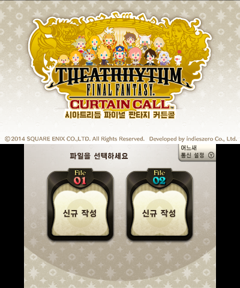
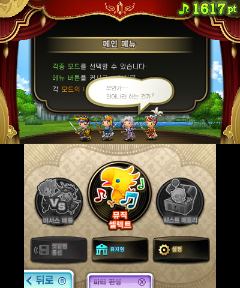
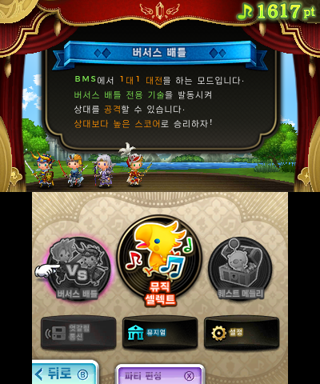
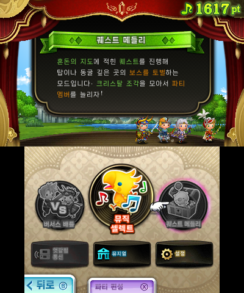
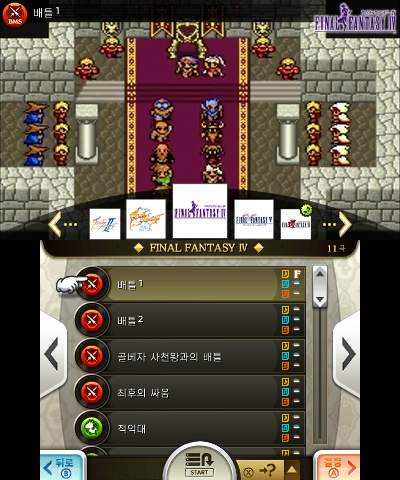
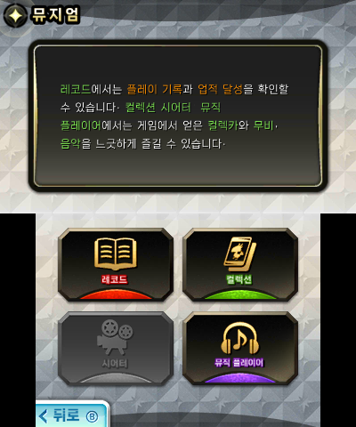
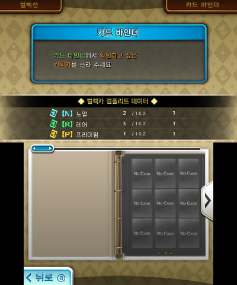
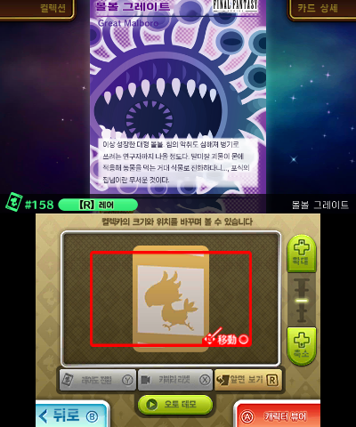

# 시아트리듬 파이널 판타지 커튼콜 3DS 한글패치

닌텐도 3DS 일본판 **시아트리듬 파이널 판타지 커튼콜(THEATRHYTHM FINAL FANTASY CURTAIN CALL)**용 비공식 한국어 패치입니다. 메뉴, 도움말, 곡 이름, 콜렉션 카드 설명, 그림 글자를 한국어로 바꿨습니다.

- **게임 문장:** 메뉴·안내 문구, 튜토리얼·도움말, 곡·작품 이름, 어빌리티·아이템·몬스터·캐릭터 이름과 설명, 업적·칭호, 퀘스트 메들리·버서스 배틀 문구, 세이브·통신 메시지
- **콜렉션 카드:** 카드 162종의 이름·설명문(카드 앞면 문자열), 카드 뒷면 그림 속 이름과 설명문, 컬렉션 화면용 축소 그림
- **그림 글자:** 타이틀·프롤로그·에필로그·튜토리얼 로고 아래 일본어 문구, 메뉴 버튼, 화면 제목, 튜토리얼 그림, 어빌리티·아이템·소환수 이름판 등
- **글꼴:** 게임 글꼴(bcfnt)마다 번역에 쓰인 한글을 추가하고, 본체 공용 글꼴을 대신할 한글 글꼴을 넣었습니다.
- **실행 파일:** 결과 화면 카드 이름 앞의 「コレカ」 서식을 「콜렉션 카드」로 바꿨습니다.

약 9,400개 문자열을 직접 번역했습니다. 현재 배포판은 **v1.1 (2026-11-27)**입니다.

[패치 다운로드](https://github.com/snake759494/theatrhythm-ff-curtain-call-3ds-korean-patch/releases/latest) · [기술 설명](docs/TECHNICAL.md) · [재빌드](docs/BUILD.md) · [변경 기록](CHANGELOG.md) · [권리 안내](RIGHTS.md)



릴리즈에 첨부한 파일은 한글패치 **Theatrhythm_FF_CurtainCall_3DS_KO_v1.1.xdelta** 하나입니다.

저장소에는 제작 소스와 한국어 번역만 공개합니다. 다음 파일은 넣지 않았습니다.
- 원본 ROM과 패치를 적용한 ROM
- 게임에서 추출한 파일
- 일본어 원문
- 글꼴 파일과 외부 실행 파일

GitHub가 자동으로 만드는 Source code ZIP/TAR는 저장소 소스를 압축한 것이며, 게임 파일이 아닙니다.

## 게임 소개 및 대상 버전

『시아트리듬 파이널 판타지 커튼콜』은 인디스제로가 개발하고 스퀘어 에닉스가 2014년 4월 24일 일본에서 발매한 닌텐도 3DS용 리듬 게임입니다. 2012년작 『시아트리듬 파이널 판타지』의 후속작으로, 파이널 판타지 시리즈와 외전 작품의 악곡 200곡 이상을 담았습니다. 터치펜이나 버튼으로 노트(트리거)를 맞히는 배틀(BMS)·필드(FMS)·이벤트(EMS) 세 종류의 스테이지를 즐기고, 시리즈 캐릭터로 파티를 짜서 성장시킵니다. 혼돈의 지도를 탐색하는 「퀘스트 메들리」, 1대1로 겨루는 「버서스 배틀」, 모은 콜렉션 카드를 보는 「뮤지엄」 등이 들어 있습니다.

이 패치는 **일본판 3DS 카드 덤프(타이틀 ID 00040000000E9A00)**에만 적용됩니다. 파일 이름보다 아래 표의 크기와 해시가 맞는지가 중요합니다.

## 적용할 원본

| 항목 | 값 |
| --- | --- |
| 타이틀 ID | 00040000000E9A00 (CTR-P-BTHJ) |
| 원본 형식 | 복호화된 일본판 .3ds (CCI) |
| **원본 MD5** | `7ca9ed572d0c3ff214c9fc3130a8ef7c` |
| 원본 크기 | 2,147,483,648 바이트 |
| 원본 SHA-1 | `fbfff5e65766209aeea1963c7d7742d5f239ccc7` |
| xdelta 파일 크기 | 81,915,426 바이트 |
| xdelta SHA-256 | `1d6e2300497e6ad471157a5df5409e72098ef6a8957c394d3debe8e1060aa21f` |
| 적용 결과 크기 | 2,147,483,648 바이트 |
| 적용 결과 MD5 | `d5a36adb48e12c82469baaa62cb6f6b4` |
| 적용 결과 SHA-1 | `93c9e5e3962d865c61c318a491aeac3be2206b48` |

원본 게임 파일은 사용자가 직접 준비해야 합니다. 암호화된 덤프라면 먼저 복호화해야 해시가 맞습니다.

## 패치 적용 방법

### 1. 해시 확인

```powershell
Get-FileHash -Algorithm MD5 -LiteralPath '.\Theatrhythm Final Fantasy - Curtain Call (Japan).3ds'
```

위 표와 다르면 적용을 중단하세요.

### 2. xdelta UI로 적용

1. 릴리즈에서 `Theatrhythm_FF_CurtainCall_3DS_KO_v1.1.xdelta`를 받습니다.
2. xdelta3 패치를 지원하는 도구에서 **Apply Patch** 기능을 엽니다.
3. **Patch**에는 xdelta 파일을, **Source File**에는 해시가 일치하는 원본 `.3ds`를 선택합니다.
4. **Output File**에는 새 파일 이름을 지정합니다(예: `Theatrhythm Final Fantasy - Curtain Call (Korean).3ds`).

xdelta는 호환성을 위해 압축 없이(`-0`) 만들었습니다. xdelta 자체는 [공식 프로젝트](https://github.com/jmacd/xdelta)를 참고하세요.

### 명령줄로 적용

```powershell
.\xdelta3.exe -d -s '.\Theatrhythm Final Fantasy - Curtain Call (Japan).3ds' '.\Theatrhythm_FF_CurtainCall_3DS_KO_v1.1.xdelta' '.\Theatrhythm Final Fantasy - Curtain Call (Korean).3ds'
```

### 3. 실행

- 결과 `.3ds`는 Azahar 등 3DS 에뮬레이터에서 바로 실행합니다.
- 결과 ROM은 암호화하지 않은 상태(NoCrypto)입니다. 실기에서 쓰려면 CIA 변환 등 사용자 환경에 맞는 방법이 필요합니다.
- v1.0에서 실기로 설정 화면에 들어가면 멈추던 문제를 고쳤습니다. 수정판은 Azahar를 Old 3DS 모드(실기와 같은 메모리 조건)로 두고 확인했습니다.

**세이브**
- 타이틀 ID가 원본과 같으므로 세이브 데이터는 원본판과 함께 쓸 수 있습니다.
- 원본판에서 만든 상태저장(세이브 스테이트)은 쓰지 마세요.

## 스크린샷

| | |
| --- | --- |
|  |  |
|  |  |
|  |  |
|  |  |

## 한글화 범위

- **문장(`message/*.mdt`, `text/*.tdt`):** 일본어 문장 전체
- **표(`table/*.csv`):** 곡·작품·캐릭터·몬스터·어빌리티·아이템·소환수·탈것·콜렉션 카드·프로피카·버서스 CPU 팀 이름과 설명
- **레이아웃(`*.arc.lz` 안의 `bclyt`):** 레이아웃에 직접 들어 있는 고정 문구
- **글꼴:** 각 아카이브의 `bcfnt`에 필요한 한글 추가, 본체 공용 글꼴 대체용 `font/cbf_std_replace.bcfnt`
- **그림 글자(`bclim`):** 타이틀 로고 문구, 메뉴·화면 제목, 튜토리얼 그림, 어빌리티·아이템·소환수 이름판
- **콜렉션 카드 그림:** 카드 뒷면(`common/image/card/ura_*.bclim.lz`) 162장, 컬렉션 축소 그림(`card_thumbnail/colleca_back_*`) 162장
- **원문 유지:** 시리즈 영문 로고(THEATRHYTHM FINAL FANTASY CURTAIN CALL), 곡 영상 속 원작 화면의 글자, 각 작품 로고, 숫자

## 알려진 한계

**확인 범위**
- Azahar에서 직접 확인한 범위는 다음과 같습니다.
  - 타이틀, 파일 선택, 메인 메뉴, 뮤직 셀렉트, 곡 플레이·결과, 뮤지엄·컬렉션·카드 상세·도움말, 설정
- 퀘스트 메들리와 버서스 배틀은 메뉴 이름, 설명창, 잠금 말풍선까지만 확인했습니다. 두 모드는 해제 조건을 찾지 못해 열지 못했으며, 모드 안 문장은 파일 단위로만 검증했습니다.
- 콜렉션 카드 상세 화면 아래 화면의 작은 「移動」 아이콘 글자는 아직 일본어입니다.
- 설정 화면 크래시 수정은 Azahar의 Old 3DS 모드에서 재현과 해결을 확인했으며, 실기에서는 아직 다시 확인하지 못했습니다.

진행이 멈추거나 글자가 깨지는 곳이 있으면 이슈로 알려 주세요. 스크린샷과 장소를 함께 올려 주시면 빨리 고칠 수 있습니다.

## 재빌드

[docs/BUILD.md](docs/BUILD.md)를 참고하세요.
